# Nesto Panel firmware

Turns a retired Nest Learning Thermostat (2nd generation) into a Home Assistant
room panel. Turn the ring and press to control the lights, climate, covers,
switches and scenes of a room. The panel also shows Home Assistant's
notifications and a clock while idle, and reports the thermostat's
temperature, humidity, light and motion sensors.

<table>
  <tr>
    <td align="center">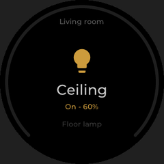<br>The room, item by item</td>
    <td align="center">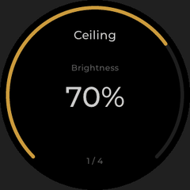<br>Brightness</td>
    <td align="center">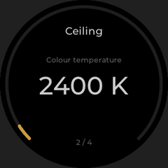<br>Colour temperature</td>
    <td align="center">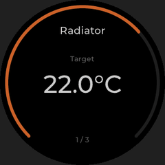<br>Climate</td>
  </tr>
  <tr>
    <td align="center">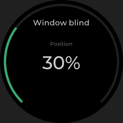<br>Covers</td>
    <td align="center">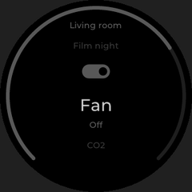<br>Switches</td>
    <td align="center">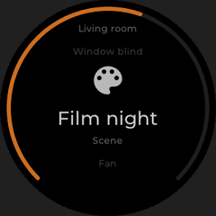<br>Scenes and scripts</td>
    <td align="center">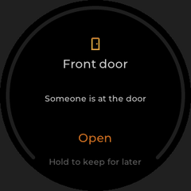<br>Notifications</td>
  </tr>
  <tr>
    <td align="center">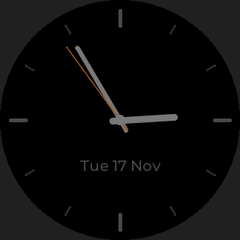<br>Standby clock</td>
    <td align="center">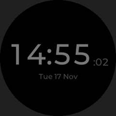<br>Or a digital one</td>
    <td align="center">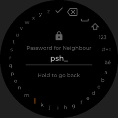<br>Wi-Fi, typed on the ring</td>
    <td align="center">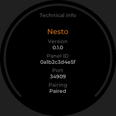<br>Technical info</td>
  </tr>
</table>

Nesto ("nest" in Esperanto) is the software that runs on the thermostat. It
works with the [ha-nesto](https://github.com/jorgediez/ha-nesto) Home Assistant
integration, which discovers the panel, pairs with it and decides what it shows.
Everything stays on your network: no cloud, and no Home Assistant token on the
panel.

> **Status: first release (0.1.0).** Nesto replaces the thermostat's own
> software, so the thermostat no longer controls any heating. It installs for
> good, starts at every boot, and can give the thermostat back to the stock
> software at any time ([docs/INSTALL.md](docs/INSTALL.md)). It talks to the
> thermostat's base, which would otherwise reset it after 30 minutes
> ([docs/BACKPLATE.md](docs/BACKPLATE.md)), and rests the display to keep the
> battery up. It has been tested on one thermostat (display Display-2.14, EU
> base Backplate-3.2) on a USB stand; running on a wall's heating wires is
> untested. The protocol between the panel and Home Assistant is in
> [PROTOCOL.md](PROTOCOL.md).

## Install

> **Use at your own risk.** Nesto is a personal project, provided as is,
> without warranty of any kind (see the [licence](LICENSE)). Rooting the
> thermostat and installing Nesto can leave it unusable. The authors aren't
> responsible for any damage, data loss or other harm, to the thermostat,
> your heating or anything else. Only use it on a thermostat you no longer
> need, and back it up first.

Download a [release](https://github.com/jorgediez/nesto-firmware/releases)
and follow [docs/INSTALL.md](docs/INSTALL.md): root the thermostat with
unfr0zen, then `sh install.sh <nest-ip>` from the unpacked release, from
Linux, macOS, or Windows with WSL or Git Bash. No build is needed. The same
script updates Nesto, gives the thermostat back to the stock software, and
uninstalls it.

## What it does

**The room.** Home Assistant sends the panel a room: its lights, climate,
covers, switches, scenes and sensors, in the order chosen in the
integration's options. Turn the ring to choose an item, press to open it,
turn to change it, press to step through its controls (brightness, colour
temperature, colour and effect; target, mode, preset and fan; position and
tilt), and hold to go back. On the home screen, a press switches a switch or
runs a scene, and holding switches a light.

**Notifications.** Home Assistant's notifications pop up, waking the panel as
their priority says, and wait in a list the home screen opens. The ring
chooses a button or Dismiss, a press sends it, and holding keeps the
notification for later. A critical one beeps every 30 seconds until it's
answered.

**Resting.** After 30 seconds without input (or what Home Assistant sets),
the display fades to a standby clock, analog or digital, or turns off. The
ring, a press or someone coming near wakes it, and the input that wakes it
does nothing else. It wakes to the top of the home screen: the Notifications
entry while there are any, else the first item. The light sensor scales the
brightness down to a quarter in the dark, slowly, so a hand or a shadow
doesn't dim it.

**Sound.** The beeper clicks when a turn of the ring changes the screen
(nothing at either end of a list) and, if Home Assistant turns it on, on a
press. Notifications beep, and `identify` beeps while the backlight pulses.

**Sensors and presses.** With its base, the panel reports temperature,
humidity, light, motion, someone near, and its battery and supply voltages.
Every press gesture is an event for automations, including a double press
while it rests, which doesn't wake it.

**Settings**, the last entry on the home screen (or a press on the waiting
screen):

- **Pair**: lets Home Assistant pair again for 5 minutes, for instance to
  move to another Home Assistant;
- **Forget**: after a confirming press, forgets Home Assistant and drops the
  connection (holding cancels);
- **Wi-Fi**: the networks around, the one in use first, then the strongest,
  and **Other network** for a hidden one (its name, then whether it has a
  password). A network that needs a password asks for it on a ring keyboard,
  like the stock software's: the ring moves round the keys, a press types,
  and the first keys are OK, delete, space, shift and the other pages
  (digits, symbols, accented letters); holding goes back. Open networks and
  WPA Personal ones can be joined; Enterprise and WEP are listed but not
  offered. If the new network isn't up within a minute, the thermostat goes
  back to the one before. A saved network offers **Join** and **Forget**
  (the one in use, Forget only: the thermostat then joins another saved
  network if it can), and asks for its password again if joining fails;
- **Technical info**, like the stock software's, scrolled with the ring:
  - **Nesto**: version, panel ID, port, pairing, how long it's been running, free memory;
  - **Home Assistant**: whether it's connected, its version, the integration's version and the round trip;
  - **Network**: Wi-Fi name, security, signal, frequency, interface, IPv4 and IPv6 addresses and routers, name servers, search domains, MAC address;
  - **Power** and **Sensors**, with a base: battery, USB and supply voltages, temperature, humidity, light;
  - **Display**: model, hardware, serial number, time zone;
  - **Base**, with one: whether it's connected, its software, model and serial number.

Hold to go back from any of them.

Not in this release: a picture carousel while resting, languages other than
English, and rebooting from Home Assistant.

## Development

Everything builds inside a Docker container, so the only requirement is Docker.
On Windows, run the commands from WSL (Ubuntu), where WSLg shows the
simulator's window on the Windows desktop, or from Git Bash with
`MSYS_NO_PATHCONV=1` set.

```bash
scripts/dev.sh image   # once, and after changing docker/Dockerfile
scripts/dev.sh build   # simulator, the thermostat's program, and the tests
scripts/dev.sh test    # unit tests, natively and on emulated ARM
scripts/dev.sh e2e     # the real panel against the Python client, natively and on emulated ARM
scripts/dev.sh sim     # open the simulator
```

In the simulator, the mouse wheel or arrow keys turn the ring, and the left
mouse button, Space or Enter press the display. M stands for someone coming
near, as the thermostat's proximity sensor would, and F for someone moving
in the room, as its motion sensor would. L sets the room's light in turn to
dark, lit and bright, as the thermostat's light sensor would; until it's
pressed there's no sensor. Escape quits.

`scripts/dev.sh sim --fake-base` gives the simulator a base, as the thermostat has: fixed
temperature, humidity and voltages, the light from L, and motion from M and F.
The panel then sends Home Assistant its `sensors` messages, as it does on the
thermostat ([PROTOCOL.md](PROTOCOL.md) section 17). It always sends each
press gesture as an `input` event, including the double press in standby or
off, which doesn't wake the display and is there for automations.
`client demo` prints both.

`client demo` (below) also tries what the panel does. It sends a notification with
`--notify "Someone is at the door" --title "Front door" --icon door --priority
high --action open=Open --action ignore=Ignore`, and tries the settings with
`--press-click`, `--no-ring-click`, `--no-notification-sound`,
`--no-motion`, `--timeout N`, `--clock digital`, `--seconds` and `--hour12`.
The simulator logs its tones instead of beeping.

The simulator listens for Home Assistant on port 6170 and announces itself over
mDNS as a `_nesto._tcp` service, which is how Home Assistant discovers it
(`--no-mdns` turns that off). In Docker, the announcements stay inside Docker's
network, so from outside the panel is reached by address.
`tools/nesto_client.py` stands in for Home Assistant during development. With
the simulator running:

```bash
scripts/dev.sh client pair      # type the code the simulator shows
scripts/dev.sh client demo      # serve a made-up living room to the simulator (--timeout N, --no-motion, --clock digital, --seconds, --hour12)
scripts/dev.sh client connect   # or: authenticate, synchronise, print what the panel sends
```

With `client demo` running, the simulator shows the room, and the demo
carries out each change as Home Assistant would and prints it. The pairing is
kept in the build volume, so it survives restarts; Settings → Pair lets the
client pair again after `client.key` is lost. In the simulator the Wi-Fi
networks are made up, and a password starting with "wrong" fails.

Screens can also be captured without a window. CI does this against the demo
room, and keeps the screenshots:

```bash
scripts/dev.sh screens screenshots              # every screen, into screenshots/
scripts/dev.sh shot screenshots/x.png "r+2 p"   # one screen, without Home Assistant
scripts/dev.sh readme-images                    # the README's pictures, into docs/images/
```

The steps are `r+N`/`r-N` (turn the ring N clicks, as many wheel notches),
`p` (press), `h` (long press), `m` (someone near) and
`wN` (wait N ms). See `src/core/InputScript.hpp`.

### Layout

| Path | What's there |
|---|---|
| `src/core/` | Logic with no hardware or LVGL dependency, covered by unit tests, including the backplate's protocol ([docs/BACKPLATE.md](docs/BACKPLATE.md)) |
| `src/protocol/` | The link to Home Assistant: framing, messages, pairing and encryption ([PROTOCOL.md](PROTOCOL.md)) |
| `src/room/` | The room: Home Assistant's layout and states, and what the ring and press do with them |
| `src/hal/` | The hardware interface, with the simulator (`sim/`) and the thermostat (`nest/`) |
| `src/app/` | The main loop and the screens, built with [LVGL](https://lvgl.io) |
| `src/probe/` | `nesto-probe`, the read-only check of a real thermostat ([docs/DEVICE.md](docs/DEVICE.md)) |
| `tests/` | Unit tests ([doctest](https://github.com/doctest/doctest)) |
| `tests/e2e/` | End-to-end tests: the real panel program against the Python client over TCP, and against python-zeroconf for discovery |
| `tools/` | The protocol's Python reference implementation, a client that stands in for Home Assistant, and the test vector generator |

### Protocol test vectors

`tests/vectors/protocol-v1.json` holds pairing codes, keys, MACs and encrypted
frames computed by the Python reference in `tools/`. The panel's tests check
its own results against them, and the Home Assistant integration does the same,
so both sides agree byte for byte. After changing the protocol's cryptography,
regenerate the file and commit it; CI fails if it's stale.

```bash
scripts/dev.sh vectors
```

### The thermostat's program

The thermostat has an ARM Cortex-A8 and glibc 2.19, from 2014, so its program is
cross-compiled with a [Bootlin](https://toolchains.bootlin.com) toolchain (GCC
and musl) and linked fully statically: it needs nothing from the device. The
toolchain comes with the dev image; `cmake/toolchain-nest.cmake` sets it up.

```bash
scripts/dev.sh check-arm   # static, 32-bit ARM, no instructions the Cortex-A8 lacks
scripts/dev.sh dist        # the stripped programs, in dist/nesto and dist/nesto-probe
```

The simulator and the tests are also built for ARM and run under QEMU emulating
a Cortex-A8, so the code runs on the thermostat's instruction set before it gets
there. `scripts/dev.sh shot-arm` takes screenshots with that build; CI checks
they match the native ones pixel for pixel.

Everything built into the program, its version and licence, is listed in
[THIRD_PARTY.md](THIRD_PARTY.md).

### On a real thermostat

Before Nesto runs on a thermostat, a read-only check describes it: what runs
the stock software, the watchdog, Wi-Fi, the screen, the ring and the
backplate, and whether its 2.6.37 kernel runs our programs. Root it with
unfr0zen and run the check, then run Nesto in the stock software's place for
a while, as [docs/DEVICE.md](docs/DEVICE.md) explains:

```bash
scripts/dev.sh device-check <nest-ip>             # the report goes to device-reports/
scripts/dev.sh device-screen <nest-ip> trial      # stop the stock software for 5 minutes, watch, restart it
scripts/dev.sh device-run <nest-ip> input-test    # print what the ring and the press send
scripts/dev.sh device-run <nest-ip> backplate-test  # talk to the backplate, printing every frame
scripts/dev.sh device-run <nest-ip> light-test      # light sensor readings, backlight off and on
scripts/dev.sh device-run <nest-ip>               # run Nesto for 10 minutes, then restart the stock software
scripts/dev.sh client --host <nest-ip> pair       # meanwhile, pair with it (then: demo)
scripts/dev.sh device-run <nest-ip> detach        # run Nesto for an hour, apart from SSH, watching the battery
scripts/dev.sh device-log <nest-ip> [follow]      # that run's log, into device-reports/
scripts/dev.sh check-report                       # run the device scripts in busybox, as CI does
```

To keep Nesto on the thermostat for good, started at every boot
([docs/DEVICE.md](docs/DEVICE.md), "Installing Nesto for good"):

```bash
scripts/dev.sh device-install <nest-ip>           # install it, and start it
scripts/dev.sh device-install <nest-ip> update    # a new Nesto, after a change
scripts/dev.sh device-status <nest-ip>            # the mode, what runs, Nesto's log
scripts/dev.sh device-mode <nest-ip> stock        # the stock software from now on (nesto: back)
scripts/dev.sh device-uninstall <nest-ip>         # the stock software back for good
```

Holding the display while "Hold to start Nest" shows, in the first seconds
after Nesto starts, gives the thermostat to the stock software until the next
boot.

`nesto-probe` (`src/probe/`), the check's program, is built with the rest and
tested natively and under QEMU. What a real thermostat showed is in
[docs/DEVICE.md](docs/DEVICE.md).

### Fonts and icons

Text is Montserrat and icons are Material Design Icons, the set Home Assistant
uses, so an icon name from Home Assistant needs no translation. At build time
`tools/make_fonts.py` cuts both down to what the panel draws (Latin-1 and Latin
Extended-A for text, which cover Spanish and Esperanto, and about 30 icons) and
embeds them; LVGL draws them at runtime at any size. To add an icon, add it to
`ICONS` in that script and to PROTOCOL.md appendix C.

## Contributing

Reports from real thermostats help most: there are issue forms for bugs, for
how Nesto does on your thermostat, and for ideas. See
[CONTRIBUTING.md](CONTRIBUTING.md) for what makes a report useful and how to
work on the code, and [SECURITY.md](SECURITY.md) to report a vulnerability
privately.

## Not affiliated

Nesto is an independent project. It is not affiliated with, endorsed by or
supported by Google or Nest Labs. "Nest" is a trademark of Google LLC, used here
only to say which hardware this software runs on.

## License

[MIT](LICENSE).
